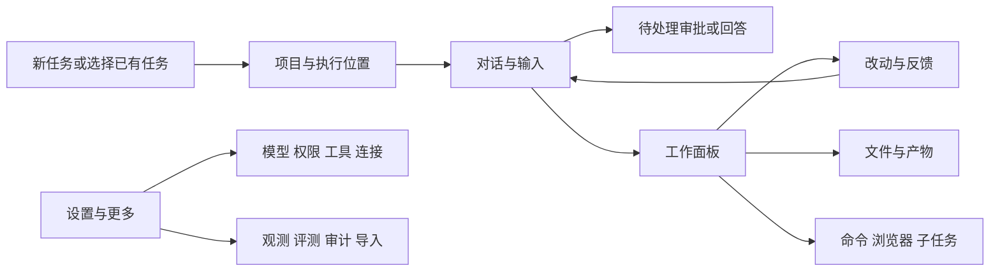

# 界面与信息架构

本文所有线框、尺寸和菜单均为 **建议的 Tern 目标界面**。现有截图仅作诊断，参考语义见 [证据](05-evidence.md)。需求 ID 见 [功能清单](01-current-and-gaps.md)。

## 1. 页面骨架

```text
┌────────────────┬────────────────────────────────────┬──────────────────────┐
│ Tern      收起 │ 项目 / 任务标题             ⋯      │ 工作面板       关闭 │
│ ＋ 新任务      │ dev · ~/workspace/tern · 原目录     │ 改动 文件 命令 …   │
│ 搜索任务       ├────────────────────────────────────┤ 范围：[工作目录 ▾] │
│ 待处理 2       │ 待你处理：1 项审批        [查看]   │ 文件列表 + 统计    │
│                │                                    │                    │
│ 置顶           │ 用户要求                           │ src/a.go  +12 −3   │
│   发布前检查   │                                    │ 旧/新行号与 diff   │
│ 项目       ＋  │ 活动摘要：读 3 个文件 · 运行检查 ▾ │                    │
│ ▾ tern · dev   │ 进展说明 / 等待卡片 / 最终结果     │ [+] 添加反馈       │
│   修复登录 ●   │                                    │                    │
│   整理 spec    │                                    │                    │
│ ▸ 另一个项目   ├────────────────────────────────────┤                    │
│ 最近任务       │ 下一轮队列 2 条             展开  │                    │
│   无项目讨论   │ 引用：a.go:12  ×                   │                    │
│                │ 输入消息…                          │                    │
│ 工具与集成     │ +  模型 ▾  权限 ▾  推理 ▾         │                    │
│ 设置 · 更多    │ [补充当前轮 ▾] [发送] [停止]       │                    │
└────────────────┴────────────────────────────────────┴──────────────────────┘
```

默认不打开右侧面板，主内容保持阅读宽度。任务标题区保留「查看改动」「打开工作面板」；导出、分叉、旁支、归档、诊断、复制 ID 放入更多菜单。当前目标存在时显示一行摘要；未设目标时不用常驻占位抢标题空间。

### 导航结构



### 入口迁移表

| 现有入口 | 目标位置 | 保留规则 |
| --- | --- | --- |
| 工作区筛选下拉 | 项目树 + 搜索范围 | 原筛选能力保留；同名项目显示主机/路径 |
| 设置里的工作区管理 | 项目菜单；设置中保留项目管理页 | 添加时仍浏览执行主机的目录 |
| Skills / MCP | 工具与集成的两个子页 | 进入可见启用、来源、授权、连接状态 |
| 长期记忆 | 设置 → 个性化/记忆 | 查看、编辑/删除的现有权限不变 |
| 评测与归因、审计 | 更多 → 开发者工具 | 原数据和功能保留；任务诊断可带当前任务进入 |
| 对话 / 观测顶栏切换 | 对话为主；更多 → 诊断此任务 | 直接打开旧观测地址仍可用 |
| 导入、导出 | 更多 → 导入；任务菜单 → 导出 | 导入记录仍只读，不伪装成可续聊任务 |
| 沙箱文件、改动、后台命令 | 统一工作面板标签 | 清晰标明各自目录/生命周期 |
| 主机菜单 | 顶栏执行位置 + 设置 → 连接 | 当前不可用也保留主机身份，不能静默换本机 |

## 2. 新任务页

```text
                      今天要完成什么？

    [项目：tern ▾] [执行位置：dev] [原目录 / 隔离副本 ▾]
    ~/workspace/tern · 分支 main · 有 2 个未提交文件

    ┌─────────────────────────────────────────────────┐
    │ 描述目标；可附图、引用文件或选择命令             │
    │                                                 │
    │ [上下文条]                                      │
    │ +  [模型 ▾] [自动编辑 ▾] [推理：高 ▾]     [发送]│
    └─────────────────────────────────────────────────┘
```

- 无项目是有效选择：说明只能使用本任务被允许的工具和临时产物空间，不擅自默认到上一个仓库。
- 项目选择器支持搜索、最近使用、添加目录；目录候选与“最近使用”语义不同，不继续用目录修改时间冒充最近使用。
- 隔离副本说明包含起点：当前代码及未提交改动的基线，不暗示可选任意分支已实现。
- 首次缺模型/主机时，在输入区附近提示修复入口；保留输入。不能点发送后才用一大段原始错误解释环境未配置。
- 初始设置保持继承；用户显式选过的值不能被迟到的默认配置请求覆盖。

## 3. 侧栏

顺序为新任务、搜索、活动、置顶、项目、最近任务，底部固定工具与集成、设置与更多。原“待处理”成为活动中心的快捷筛选，保留醒目的数量。最近任务可以重复出现项目里的任务，这是快捷访问，不是另一个对话副本。

项目行：折叠箭头、名字、主机标签、更多、新任务；任务行：简短标题、运行/待处理/失败图标、未读点、更多。标题截断可悬停看全，但不能把整段首问作为默认可见标题。没有显式名字时先显示截断首问，后台标题生成如有失败不影响使用；用户改名优先。

- “待处理”包含等待审批和等待回答，显示数量；未读与待处理分开，不用同一个蓝点表达。
- 归档从更多菜单进入，不把全部历史展开挤占当前工作。
- 归档不停止运行、删除会影响哪些数据必须提前说明；前端确认由现有删除语义决定，不能把删除文案变成可恢复却没有恢复能力。
- 第一版置顶按个人持久化；自定义分组/手动排序不是第一版验收要求。

## 4. 消息与活动

| 内容 | 默认呈现 | 展开后 |
| --- | --- | --- |
| 用户输入 | 原文、附件、上下文引用 | 更多：复制、编辑重发、从这里分叉 |
| assistant 进展 | 清楚的一段工作说明 | 保持原文，不能把工具输出伪装成模型总结 |
| 常规探索 | “读取 3 个文件，搜索 2 次”一行 | 文件/查询/耗时与具体输出 |
| 命令 | 命令摘要、运行/退出状态 | 命令原文、输出、目录、权限范围 |
| 修改文件 | 文件名 + 变更统计，可打开改动 | 必要的操作详情，不默认铺全文 diff |
| 错误 | 原因摘要 + 可执行下一步 | 错误原文、关联操作；不自动重试有副作用操作 |
| 等待审批/回答 | 直接展开的操作卡片 | 请求详情、作用范围；处理后压成结果一行 |
| 最终结果 | 完整 Markdown；复制和查看改动 | 用时/上下文等次要信息 |
| 原始输入/输出、Hook、记忆调用 | 诊断入口中查看 | 保留现有可追溯数据 |

滚动规则：人在底部才跟随；向上阅读后不被增量输出拉回；显示“有新内容/回到底部”。展开工具、选中文字、切右侧标签不得让对话跳动。审批出现时显示可定位提示，不自动把用户从正在读的位置拽走。

## 5. 输入区

固定三层：上下文与附件条 → 多行文本 → 模型/权限/推理与动作。项目与执行位置在标题上下文中，不让一排禁用下拉永久占据输入区。

- 空闲：主要动作“发送”；运行中有文本：主要动作“补充当前轮”，旁边可选“排到下一轮”；停止是独立按钮。
- 输入失焦、切换任务、打开设置之前先保存草稿；草稿与已提交队列不混用。
- `@` 文件、`/` 命令保留；补全占用的方向键/Enter/Esc 只作用于打开的补全层。
- Enter 发送，Shift+Enter 换行；IME 组合输入的 Enter 只确认文字；Tab 导航焦点。快捷键菜单显示当前浏览器实际可用组合，不照搬会被浏览器拦截的键。
- 图/文件上传失败在对应项上重试、移除；切模型导致图片不兼容时保留附件，给出原因。
- 队列显示为独立列表，可编辑、排序、删除；“已被 agent 取走”后不能继续表现为可编辑。详见 [交互](03-interactions.md)。

## 6. 工作面板

功能分类为改动、文件、命令、浏览器、子任务；每类下允许打开多个资源实例，按 EXT-08 统一管理标签。不存在该能力时说明原因；没有内容时显示空态。一个时刻显示一个活动工作视图，但切换实例保留状态，不能停止后台工作；不要求同时把五类面板全部平铺。

### 改动与反馈

```text
改动       [范围：整个工作目录 ▾]       [刷新]
dev · tern · main  | 比较基准：HEAD abc123
包含你和 agent 的改动，共 3 个文件    +20 −8
┌文件列表─────────┬───────────────────────────┐
│ M src/a.go      │ src/a.go           已变化 │
│ A docs/guide.md │ 旧行号 新行号   diff      │
│ …               │  12     12     原始内容  │
│                 │        +13     新增内容  │
│                 │ [+ 对这一行提意见]        │
└─────────────────┴───────────────────────────┘
反馈草稿 2 条                       [加入输入]
```

首版默认保持当前范围：普通任务“整个工作目录相对 HEAD”，副本“副本相对基线”。新增范围必须由服务端给出真实比较结果；“最近一轮”不能只过滤文件名就宣称只有该轮变化。

行反馈显示路径、左右侧、行号、短代码片段、基准版本；发送前可删除/改写。首版不提供有名无实的暂存/提交/推送按钮。后续 Git 操作只在已实现并协商能力后显示。

### 文件与命令

- 文件标签分“项目文件”和“任务产物”。前者第一版只读；后者复用沙箱文件上传/下载能力。响应中由服务端判定可读取范围。
- 点击消息中的文件链接在面板打开并定位；文件不存在显示不存在，不能偷偷创建。跨主机链接保留来源主机。
- 命令标签先容纳现有 `!` 与后台命令，并显示不同生命周期；尚不叫“终端”。未来真正终端的输入、粘贴、resize 与断连恢复另立设计。
- 浏览器和子任务可因新活动增加状态点，不自动覆盖用户打开的 diff/文件。

### 子 agent 协作视图

主对话增加轻量协作摘要，显示每个子任务的职责、真实状态、等待事项；点击进入工作面板的子任务列表与详情。详情默认概览和结果，执行轨迹按需展开；父任务与子任务之间返回时保留阅读位置。同一子任务的续跑归为多次尝试，不生成多个无关联的“子 agent N”。

子任务审批汇入主任务待处理区并标明来源；实际上下文模式、目录共享关系和父轮结束时的停止规则必须可见。直接发消息、停止单个子任务是后续有协议支撑的操作，不能由纯前端按钮冒充。完整线框与交互见 [子 agent 专项](06-subagents.md#3-页面与组件)。

## 7. 设置界面

| 分类 | 内容 |
| --- | --- |
| 常规 | 主题、字体/密度（后续可选）、通知、快捷键、发送偏好 |
| 模型 | 可用模型、默认模型、缺配置原因、所属执行主机；供应商细节进二级 |
| 项目 | 登记目录、显示名、默认执行方式、项目配置来源 |
| 权限 | 默认权限、规则、联网范围；展示实际生效项和来源 |
| 工具与集成 | Skills、MCP、授权与连接状态 |
| 连接 | 主机列表、连接故障、安装/版本/指纹操作 |
| 个性化 | 个人指令位置、记忆管理 |
| 高级/关于 | Hooks、预算、上下文、web/backend 版本、诊断入口 |

每个设置明确“立即影响界面 / 下一轮生效 / 新任务生效 / 所有用户默认”。保留继承来源，不把平台默认和个人设置放成两个近似的无说明保存按钮。

## 8. 视觉与浏览器适配

新增命令面板、活动中心、显式 Skill 引用、上下文面板、项目操作、预览批注、多资源标签与 Goal 进度条的界面契约，见 [工作流补充](07-workflow-completeness.md)。其批注先形成草稿再发送，与代码行反馈使用一致的输入规则；页面控制与文件预览沿各自权限边界处理。

以下为实现初始建议，可在同一轮视觉验收中微调并回写：

| 项 | 目标 |
| --- | --- |
| 空间 | 4px 基础间距；常用 8/12/16/24；避免每卡各自定义密度 |
| 字体 | 对话正文 15px、行高约 1.65；导航/操作 13–14px；代码 12–13px；中文系统字体优先 |
| 主内容 | 阅读宽度约 760–880px；分栏时至少 440px；不足时不硬挤 |
| 侧栏 | 默认约 248px，可收起；工作面板约 420–640px，可调整 |
| 宽屏 ≥1280px | 可显示侧栏、对话、工作面板；保持独立滚动 |
| 900–1279px | 打开工作面板时侧栏优先收起；不足最小宽度则用覆盖面板 |
| <900px | 导航抽屉；工作面板全宽层；返回对话保留草稿与位置；底部输入不被软键盘遮挡 |
| 颜色 | 中性背景、弱分割线、有限强调色；复用现有 light/dark token，增加手动选择 |
| 状态 | 图标 + 文案，不能只有颜色；正常信息不铺警告黄条 |
| 可访问性 | 明确焦点环；常规文本目标对比度 ≥4.5:1；触屏主要动作 ≥44px；减少动画偏好可用 |

截图验收至少覆盖 1440×900、1128×900、768×1024、390×844 和明暗主题。宽度目标相加放不下时应切换布局，不通过压缩字体解决。文案、禁用态和空态同样纳入截图检查。
