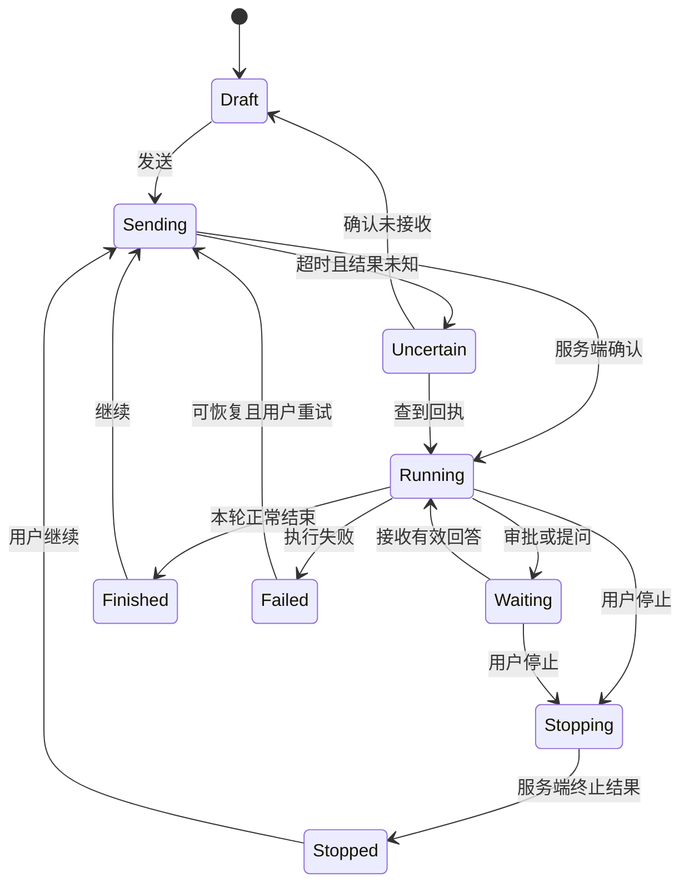

# 用户流程、状态与行为契约

状态：目标设计，尚未实现。与旧实现不同的地方需要先补对应实现 spec；本文件不宣称新增协议已存在。需求对应 [差距表](01-current-and-gaps.md)，页面对应 [界面](02-interface.md)。

## 1. 用户看到的对象

| 对象 | 含义 | 必须避免的混淆 |
| --- | --- | --- |
| 项目 | 某台执行主机上的一个登记目录，组织相关任务 | 项目显示名不是目录身份；同名目录不能合并 |
| 任务 | 一段可持续多轮的对话，关联执行位置和产物 | 不能因为一轮结束就永远标“整个任务完成” |
| 本轮 | 一次用户输入驱动的执行，可接收补充消息 | 排队消息尚未成为本轮；停止也不是撤销 |
| 执行位置 | 实际运行 app-server/agent 的主机与目录 | VM 中的“本机”不是用户浏览器所在的 Mac |
| 原目录 / 隔离副本 | 直接在项目目录操作 / 在独立 clone 操作 | 分叉对话不自动产生副本；副本不是 worktree |
| 计划 / 目标 | 计划是待执行步骤，现有目标是长期方向提醒；新增 Goal 是显式启动的持续执行模式 | 现有目标文字不会自动迁移为 Goal；Goal 需完整调度与停止契约 |
| 改动 | 指定比较范围内的文件变化 | 仓库所有改动不能叫“agent 这轮改动” |
| 工作面板 | 对话关联的文件、差异、命令、浏览器、子任务视图 | 打开视图不授权新操作，也不改变执行位置 |

第一版“任务”是 UI 名称，继续使用原 thread ID；“本轮”继续使用原 turn。历史记录不为改文案而改写。

## 2. 创建任务

入口有全局新任务与项目行的新任务。全局入口可以选无项目；项目入口明确预选该项目及其主机。设置继承和显式选择的优先顺序继续使用现有规则。

1. 用户选项目、执行方式、模型，输入要求和引用。
2. 页面读取实际主机连接状态、模型可用性和目录信息；没有权限或目录消失时保留草稿并说明。
3. 点击发送：立即显示“正在发送”。重复点击不得创建重复任务；这需要客户端请求 ID 和服务端去重契约，不能只禁用按钮。
4. 服务端返回任务 ID 后再把该草稿标记已发送；进入稳定任务链接。创建副本失败则留在草稿，不出现“成功任务 + 坏目录”的半成品。
5. 若请求超时而结果未知，显示“正在确认是否已创建”，按请求 ID 查询；确认未创建后才能重试。服务端没支持前不得自动重试有副作用请求。

发送与审批默认不隐式提升权限；创建任务不顺带连接另一个主机、复制密钥或初始化 Git。对应动作由明确按钮和说明触发。

## 3. 执行状态与连接状态分开

图中为产品状态名，不是要求立即改写现有事件枚举。实现 spec 需逐项列出现有事件到展示状态的映射；证据不足时显示未知，不猜测完成。

| 场景 | 用户看到什么 | 允许的动作 |
| --- | --- | --- |
| 正在工作 | 活动摘要、计时、补充/排队、停止 | 补充要求，查看任何历史与面板 |
| 等待审批/回答 | 顶部待处理条 + 具体卡片 | 回答或拒绝；查看详情；停止 |
| 正在停止 | “正在停止，等待当前操作结束” | 不触发自动续跑；必要时二次强制结束 |
| 已停止 | 保留输出、可能已产生的改动、未发送队列 | 用户决定继续、检查、删除队列 |
| 本轮结束 | 最终回复与可核验结果 | 继续、看改动、归档 |
| 执行失败 | 失败步骤、能否续聊、重试范围 | 由人选择重试；有未知副作用先核查 |
| 连接中断 | 连接横幅，最后确认状态与时间 | 浏览已加载内容、编辑草稿；禁用远端变更 |
| 导入历史 | 明显只读标签 | 阅读、搜索、导出；不能把输入框留成可发送 |

连接是覆盖在执行状态之上的另一维度：断线不等于 agent 已停止，重新连上也不等于重新执行。浏览器到 web、web 到 app-server 两段连接都要呈现；不能拿后者已有重连机制当作前者已恢复的证据。

## 4. 补充、排队、停止

### 补充当前轮

- 沿用已有 steer：下一次适当的模型请求采纳，不承诺中断正在执行的工具。
- 页面先显示“等待采纳”，收到相同 client ID 的采纳事件后才进入已发送历史。
- 当前轮刚好结束：仍未被采纳的补充明确显示“本轮已结束，等待续发”；由一处服务端状态负责后续处理，不能多个页面各发一次。
- 新实现需要把目前依赖发送页面存活的未采纳补充补成可恢复状态。没有迁移完成前必须保留旧行为说明，不能显示“已持久保存”。

### 下一轮队列

- 服务器持有列表；页面展示已接收内容、顺序、编辑版本；当前第一条被领取后从“可编辑”变为“已开始”。
- 编辑、删除、排序与领取竞争时，服务器返回新版本和冲突原因；页面刷新，不以覆盖写法把已开始消息放回。
- 正常完成可按既有规则执行下一条。用户停止后队列保留，必须显式“继续队列”；界面不自动重新唤起工作。
- 发送队列项和移除队列项应是可去重的一个服务端消费过程；不得用“先发成功、后删失败”造成重复消费。

### 停止

- 停止是控制执行，不清空输入、历史、附件、已写文件。第一次正常停止，仍未退出时允许强制结束，明确说明可能丢失尚未回填的输出。
- Esc 优先关闭补全/菜单/弹窗；不在输入组合态且没有这些层时才执行停止，规则在快捷键提示中说明。
- 停止后显示“文件修改可能已生效”；回退是独立的预览与确认流程。

## 5. 草稿、刷新和恢复

目标是“不丢输入、不串任务、不重复执行”。第一版草稿保存在本浏览器，不承诺跨设备同步。

| 数据 | 归属与恢复规则 |
| --- | --- |
| 未发送文字、输入偏好、引用草稿 | 按登录账号 + 稳定主机身份 + 任务 ID 保存；新任务按主机/项目建独立 draft ID |
| 已上传附件 | 服务端引用；本地草稿只存引用与元数据，不把二进制塞 localStorage；恢复时检查引用仍有效 |
| 队列、审批、任务状态、已发消息 | app-server 为事实源，页面重连查询并订阅 |
| 面板活动标签、宽度、滚动、展开项 | 界面偏好；按任务恢复，不把它们写进模型上下文 |
| 未读 | 首版维持浏览器本地范围，但补账号隔离；不宣称跨设备同步 |

存储失败时提示“草稿未保存”，保留当前输入，切页前提醒；退出登录后不向另一账号展示草稿。多个标签页编辑同一草稿时保存版本，出现冲突保留两份供选择，不能静默覆盖。

浏览器流恢复必须以 last received sequence 去重/补齐，并重新获取当前状态与审批；旧事件重复到达不得重复通知、重复插入消息或重新执行操作。旧链接 `/?run=…`、远端 `/h/<alias>/?run=…` 仍可打开。

## 6. 审批与回答

审批卡必须回答：**哪个任务、在哪台机器、执行什么、为什么需要你、允许到什么范围**。

- 工具审批与网络审批使用各自实际支持的选择，不强行提供同样按钮。只有服务端支持“本次/本任务/始终”中的某个范围才显示对应选项。
- “允许一次”和“始终允许”不能采用同一视觉默认权重；个人规则变更明确显示影响后续任务。
- 提问默认不自动提交预选项；选择或自由输入后明确提交。
- 多页面先到的有效回答生效，其他页面变为“已在其他页面处理”，不再重放。
- 请求已过期、agent 退出、审计写入失败时，不显示“已批准并继续”；保持真实结果和下一步。
- 不将页面菜单点击本身变成 agent 授权，更不能让模型输出一段 HTML 伪造真正审批控件。

## 7. 检查改动并反馈

1. 从轮次末尾或顶栏打开改动，默认展示明确的现有比较基准。
2. 选择范围，服务端返回该范围结果及版本标识。读取失败保留上一次数据但标“可能过期”，不能显示“没有改动”。
3. 用户在文件/某一行添加意见，先进入反馈草稿，不触发模型、Git 或对外评论。
4. “加入输入”生成可编辑的上下文引用，保留主机、任务、路径、旧/新侧、行号、版本、片段和用户意见。
5. 用户发送后才成为新消息；agent 据此修改。修改后旧意见可查看，定位失效时标记过期，不错误套到新代码。

“最近一轮”是高风险语义：现有 edit/write 检查点不能覆盖所有 bash 或人同时写入。实现前需确定完整快照来源与并发边界；不能可靠归属时显示“本轮涉及文件（含其他改动）”，不能打上“本轮精确 diff”标签。

后续暂存/提交：显示操作主机、目录、分支、范围和最新 Git 状态；执行前检查状态是否变化，失败返回原始原因及可恢复路径；不得自动 force push、自动重试提交或把界面错误当作 Git 没执行。具体协议另写实现 spec。

## 8. 分叉、副本、编辑重发

- 分叉：保留对话上下文，默认沿用实际目录；解释双方可能写同一目录。隔离副本是另一个明确选择，当前后端不支持的组合不显示成功入口。
- 旁支提问：说明问答是否进入原对话，保留回到来源的入口。
- 编辑重发：显示受影响轮次、可回退文件及无法自动回退的 bash 副作用；用户可取消。成功后保留审计，不把旧回答悄悄当从未发生。
- 应用副本：展示原目录、基线、待应用文件；有冲突时原目录不改变，给出冲突文件。成功只说明“已应用”，不说“已合并并提交”。
- 删除任务时若会删除独占副本/产物必须明确说明；归档默认保留，不能偷换成副本回收。

## 9. 设置与启动的可理解性

当前上下文摘要应来自实际任务快照，不以最新默认设置冒充历史任务环境。用户改设置时明确下一轮还是新任务生效。

关于页区分源码版本、正在运行的 web 版本、所连 app-server 版本；读不到就显示未知。源码变化或 `go install .` 不代表旧 web 进程已替换。自动重启/编译不在首版界面交付中，以后若做必须保护草稿、活动任务和启动失败时的旧服务。

## 10. 子 agent 的状态、路由与结果

子 agent 独立区分执行状态、结果回收状态和连接状态；后台 spawn 回执不代表完成，已返回主任务不代表已采用或验证通过。主任务待处理项必须保留子任务来源；用户干预明确是发给父任务还是直达子任务，停止单个子任务不停止兄弟任务。详情与验收以 [子 agent 专项](06-subagents.md) 为准。

## 11. 新增工作流的统一规则

[EXT-01–09](07-workflow-completeness.md) 补充以下交互，具体契约在专项中维护：

- 快速导航与输入历史只恢复/定位，不自动提交；活动已读不代表审批已处理。
- 显式 Skill、网页/产物批注先形成输入引用，用户发送后执行；来源、版本与目标主机可追溯。
- 手动压缩只在有效上下文切换成功后确认完成，不能丢失原历史；指标未知如实显示。
- 项目常用操作有独立实例与日志，关闭标签不停止服务，恢复标签不重跑命令。
- 普通任务仍按前文停止/队列规则执行；显式 Goal 模式下，停止当前轮同时暂停自动续轮，并由单一服务端调度协调用户队列与目标继续。既有文字目标不自动开启此模式。
