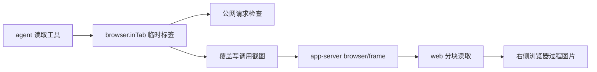
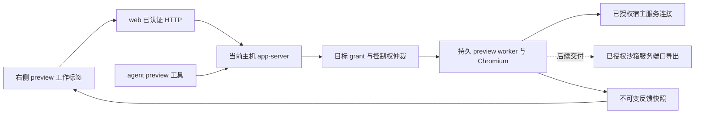

# 网页预览：持久会话、控制权与可视化反馈

状态：方案稿，未实现。日期：2026-10-25；2026-10-31 补充：T01 改走“Chrome 自有沙箱 + 只放行授权目标的代理”，原型在 Linux VM 上通过，见文末。对应 EXT-06、A36/A37，并与 WORK-08、EXT-05、EXT-08 共用能力。开发与真实验收结果仍统一记录到 [08](08-implementation.md)，不能以本文或已有浏览器截图关闭需求。

本文细化 [07 第 7 节](07-workflow-completeness.md#7-ext-06网页预览与可视化反馈)，保留其完整范围。用户明确网页、文件、diff、子智能体都属于同一个右侧工作区，布局遵守 [18](18-codex-visual-alignment.md)。本文只交付设计，不改应用实现或运行环境。

## 1. 交付目标与范围

完整流程为：**启动或连接开发服务 → 在右侧工作标签打开真实页面 → 用户与 agent 交接控制权 → 选择元素或框选区域 → 写意见并加入输入草稿 → 用户发送 → agent 修改 → 刷新页面复验**。

- 支持用户输入地址，也支持用户明确点击回答里的网页链接进入右侧预览；不能因为模型输出一个 URL 就自动授权、导航或启动服务。
- 页面必须能真实点击、输入、滚动和刷新。仅显示图片、播放工具截图或打开外部链接都不算可交互预览。
- 桌面默认保留主聊天和右侧工作区；最大化由用户明确操作，窄屏保留返回聊天入口。新网页活动不抢走正在阅读的资源。
- 选元素、框区域不触发网站业务动作。反馈带原快照与定位信息，加入输入不等于发送。
- 目标、控制者、连接失败、页面版本和反馈是否过期都必须显示真实状态。
- 不提供任意 URL 内容代理，不改写网站的 CORS、CSP、frame 策略、认证或验证码；不默认导入个人浏览器登录态，不擅自公网发布。

首个交付段连接**用户已在所选执行主机宿主网络启动**的本地开发站点。它让持久浏览器和反馈链路先具备真实验证条件，**不是整个 EXT-06，也不删除沙箱开发服务支持**。指定沙箱服务的端口导出、跨轮生命周期、停止与失败恢复仍在本方案第 5、11 节的交付范围，并与 EXT-05 协同实现。完成报告必须分别列出宿主服务和沙箱服务的实际支持情况。

首批真实环境以 Linux VM 为准；其他系统必须报告能力，不自动换到无隔离的路径。任意第三方网站、跨域登录态导入、通用云浏览器平台不作为附带承诺。网站不支持自动化或浏览器启动失败时，保留地址和原因；明确的外部打开只能是受限替代路径，不能计为 A36/A37 通过。

## 2. 已确认的代码事实

以下来自 2026-10-25 当前工作区只读检查。行号用于定位，函数名为后续追踪依据；没有读取凭据、启动模型或操作浏览器来验证新功能。

| 编号 | 已确认事实 | 证据与设计影响 |
| --- | --- | --- |
| F01 | 现有浏览器只有 `web_search`、`open_page` 两个读取工具 | [browser.go：Definitions、Rules](../../internal/browser/browser.go#L35)；[browser/AGENTS.md](../../internal/browser/AGENTS.md) 明确“只做读取型工具”。新交互能力不能悄悄扩充这两个工具的权限 |
| F02 | 每次工具调用新建标签，结束或取消就关闭 | [browser.go：inTab](../../internal/browser/browser.go#L119)，`chromedp.NewContext` 后 `defer closeTab()`；不能沿用该生命周期承载用户操作与后续复验 |
| F03 | 初始地址及页面请求拒绝本机、内网、保留 IP | [browser.go：checkURL/privateHost/guard](../../internal/browser/browser.go#L358)。guard 注释明确仍有 DNS 重绑定和 WebSocket 未覆盖边界，不能仅加一个 localhost 例外就宣称新目标隔离完成 |
| F04 | 当前实时画面是覆盖写 JPEG 后由网页约每 700ms 读取 | [browser.go：writeFrame](../../internal/browser/browser.go#L187)、[browser.js：pullFrame](../../internal/web/page/browser.js#L5)、[files.go：browserFrame](../../internal/appserver/files.go#L306)。可以复用截图技术和分块传输思路，没有现成输入控制、会话、所有权接口 |
| F05 | web 是 app-server 客户端，远程通过 SSH 标准输入输出走 JSON-RPC | [appclient/rpc.go：DialRemote](../../internal/appclient/rpc.go#L67)、[web/server.go：browserFrame](../../internal/web/server.go#L1301)、[appserver/AGENTS.md](../../internal/appserver/AGENTS.md)。web 不直接读浏览器运行目录，不另开公开 CDP 端口 |
| F06 | 现有协议单行上限 16 MiB，二进制块不超过 4 MiB | [protocol.go：Conn.read](../../internal/protocol/protocol.go#L68)、[appserver/AGENTS.md](../../internal/appserver/AGENTS.md)。实时帧不能无界塞入任务事件或放大协议限制 |
| F07 | Linux bash 每条命令使用独立网络 namespace；后台任务本轮结束终止 | [launch_linux.go：bwrapArgs](../../internal/sandbox/launch_linux.go#L269)、[jobs.go：startJob 返回说明](../../internal/sandbox/jobs.go#L124)、[sandbox/AGENTS.md](../../internal/sandbox/AGENTS.md)。VM 宿主 Chrome 无法直接访问这类服务的 localhost |
| F08 | 右侧标签已有按账号、主机、任务隔离的资源描述和阅读状态 | [workpanel.js](../../internal/web/page/workpanel.js)。复用标签系统，新增可交互 `preview` 类型；现有 `browser` 类型仍明确为工具过程 |
| F09 | 普通消息已有图片附件与草稿；当前轮补充和队列只支持文字 | [attachments.go](../../internal/appserver/attachments.go#L19)、[drafts.js：captureDraft](../../internal/web/page/drafts.js#L104)、[composer.js：steer/queueInput](../../internal/web/page/composer.js#L209)。截图引用不能冒充模型已收到图片，不能通过纯文本队列悄悄丢掉附图 |
| F10 | agent 当前直接调用 browser 包；app-server 尚不接收 preview 请求 | [dispatch.go：runTool](../../internal/agent/dispatch.go#L120)、[server.go：run.handle](../../internal/appserver/server.go#L2807)、[handle.go：methods](../../internal/appserver/handle.go#L108)。新工具必须接到同一个服务端控制权仲裁点 |
| F11 | 网页请求已有登录、同源与账号变化校验；app-server 的 `user` 不是独立身份凭证 | [auth.go：protect](../../internal/web/auth.go#L282)、[appserver/AGENTS.md](../../internal/appserver/AGENTS.md)。网页账号由认证注入；agent 身份必须从其真实 run 连接派生，不能信任模型传入的 user/threadId |
| F12 | 回答中的 HTTP(S) 链接目前直接新开浏览器页 | [md.js：mdAnchor](../../internal/web/page/md.js#L7)。正常受支持的网页入口需接入右侧工作区；受限替代操作另行明确，不自动跳出 |

实际依赖为 `chromedp v0.20.1`、`cdproto v0.157.8`，见 [go.mod](../../go.mod)。已读取 VM 模块缓存中的公开定义，确认有 `Input.dispatchMouseEvent`、`Input.dispatchKeyEvent`、`Input.insertText`、`DOM.getNodeForLocation`、`Page.captureScreenshot`、`Page.startScreencast`、`Emulation.setDeviceMetricsOverride` 和独立 BrowserContext 能力。这只证明底层 API 存在，不证明本方案的组合、网络隔离或中文输入已经验证。

当前链路：



## 3. 拟定架构与事实源

新增独立的 `internal/preview` 能力，由 app-server 拥有；不把 `internal/browser` 的读取工具改成可交互内网浏览器。Chromium 在**选定任务的执行主机**运行，页面作为 Chromium 顶层页面加载；tern 页面只承载画面和受限输入表面。



| 对象 | 事实源／所有者 | 持久化与恢复 |
| --- | --- | --- |
| 目标 grant | app-server；来自已认证用户的明确选择 | 记录目标、任务、授权人、撤销/到期状态；恢复记录不能自动重新导航或启动服务 |
| 开发服务实例 | 对应服务管理者；不是网页标签 | 已有宿主服务只连接、不接管未知进程；受控沙箱服务另有实例、日志、停止与跨轮状态 |
| preview session、controller epoch | app-server 和其自有 worker | 存描述与终态；临时 CDP 句柄不持久化为可重放命令 |
| 实时帧 | worker 内存中的有界最新帧缓存 | 不逐帧写入任务历史或 localStorage |
| 反馈 capture | app-server 私有不可变快照 | 图片字节及有限定位元数据；权限随原账号/任务，不依赖仍存活的 CDP node ID |
| 意见与输入草稿 | 现有账号/主机/任务草稿机制 | 保存文字和引用，保留冲突与失败副本；不存 cookie、认证令牌或页面全文 |
| 模型执行记录 | 原任务消息、工具事件、检查点 | 用户发送后才形成输入；预览成功不等于模型已修复，模型回答也不等于页面复验通过 |

运行目录必须是私有临时目录，目录 0700、敏感文件 0600；Chrome profile 和 Unix socket 不放项目 virtiofs。Linux 运行目录的具体选择及文件系统检查见待确定项 T01。不得复制用户已有 Chrome profile。关闭右侧标签与结束 session 分开；app-server 重启首版可明确使 preview session 失效，保留描述/反馈并要求显式重开，不承诺恢复登录态。

## 4. 目标授权契约

### 4.1 用户选择与 grant

创建 grant 的来源只能是已认证用户对当前任务的明确操作：输入地址后点击打开，或选中回答链接并确认其执行主机/目标。模型建议、页面脚本、自动扫描端口、恢复标签、读取旧任务均不创建授权。用户选择目标与“交给 agent 控制”是两项独立操作。

拟定字段如下；这些是新增协议，不是当前接口：

| 字段 | 语义 |
| --- | --- |
| `grant_id`、`revision` | 服务端生成身份和单调版本；变更/撤销需要当前版本 |
| `user` | web 注入的认证账号；agent 路径不接受此字段自行授权 |
| `thread_id`、`execution_host` | 任务和执行主机身份来自连接及任务快照；不能只靠显示名或 URL 猜测 |
| `target_kind` | `host_service` 或 `sandbox_service`；必须真实区分网络空间 |
| `origin` | 规范化 scheme、hostname、port；不使用“整个内网”“所有 localhost 端口”授权 |
| `endpoint` / `service_id` | 服务端固定的目标连接，或已经授权的受控服务身份；不接受 agent 随动作改目的地址 |
| `created_at`、`expires_at`、`revoked_at` | 生命周期；过期或撤销后停止新动作和网络连接，不自动续期 |
| `agent_access` | 是否允许本任务 agent 请求此 session 的控制；默认不授予。不是绕过工具权限的许可 |

首段只支持执行主机上的明确 loopback origin。`localhost`、IPv4/IPv6 loopback 的解析与连接固定在该执行主机；拒绝 URL userinfo、非 HTTP(S)、非法端口及不能明确解析的目标。不存在服务时保留原地址并报连接失败，不去尝试 Mac 地址、VM 网关、`host.docker.internal` 或相邻端口。

同 origin 下的路径导航可复用 grant。跨 origin 跳转、额外 API 端口、HMR 端口、弹出的另一目标必须再次由用户明确选择，不能继承宽泛授权。首段未支持的依赖显示具体阻塞；不得改响应头或浏览器安全参数让它“能用”。完整 URL 可能含敏感查询参数；不得将认证内容写入日志、遥测或聊天，持久 URL 与展示脱敏策略见 T06。

### 4.2 网络边界

现有 `open_page` 的 `checkURL/privateHost/guard` 保持原行为。preview 的授权不能设置成通用的“允许内网浏览器”开关。

**2026-10-31 起，首选路径改为“Chrome 自有沙箱 + 只放行授权目标的代理”**（原型结果见文末）：preview 的 Chrome 不套 bwrap 或网络 namespace，保留 Chrome 自己的沙箱；所有流量用 `--proxy-server` 指到 tern 的 preview 代理，并加 `--proxy-bypass-list=<-loopback>`，让 localhost 也必须经过代理；代理只放行 grant 指定的目标，放行的连接固定连到授权地址，不按请求里的名字解析。下面这段命名空间方案在 VM 上已证实与 Chrome 沙箱冲突，保留作为历史记录。

原方案：Linux 的优先实现路径是独立 preview 网络 namespace：内部只通过受控 relay 连接 grant 指定的固定目标；relay 可以转发 TCP/Unix 字节，但不接收任意 URL、不改内容、不重写 Origin/CORS/CSP/frame/TLS。这样原站点仍在浏览器自己的 origin 下运行，同一授权端点的 HTTP 与 WebSocket 能走同一边界。

该隔离路径尚未实施，worker/CDP 通道与 Chrome 沙箱是否能共同工作必须先做 T01 的真实原型验证。仅依靠 CDP Fetch 放行本地 origin 不足以完成安全验收，因为现有代码已确认 WebSocket 和 DNS 重绑定覆盖不足。不能以功能可用为理由自动退回宿主无限制 Chrome、`--share-net`、`--disable-web-security` 或关闭证书检查。

网页来自本地开发服务也仍是任务数据，不是系统指令。站点登录交给用户完成；不会把密码、cookie、按键正文或 localStorage 内容写进通用工具日志。第三方登录跳转若超出已支持授权范围，显示限制，不自动扩大 grant。

## 5. VM 与沙箱开发服务

### 5.1 宿主服务首段

页面上显示“实际执行主机 · 原始目标 origin · 连接方式”。例如任务执行主机是 VM 时，预览里的 loopback 指 VM；Mac 网页仅经 web/RPC 接收画面。若 web 在 Mac、app-server 在 VM，继续复用已有 SSH RPC，不必把开发端口暴露给 Mac。若服务实际在别的主机，要求明确选择受支持的执行目标，不自动替换地址。

已有服务的启动、重启、端口占用不由“打开预览”隐式处理。连接失败可重试读取连接状态；不能自动杀未知占用进程。开发服务本身的正常认证、CORS 和 TLS 仍由该服务负责。

### 5.2 沙箱服务仍在完整交付范围

当前 `bash background=true` 的进程、网络与生命周期都不适合直接作为跨轮开发服务。完整方案需要新增受控服务实例，至少包含：所属任务/项目、启动命令和目录、权限快照、进程或 cgroup 身份、网络空间、用户批准导出的精确端口、日志、启动/运行/退出状态、停止方式与实际终态。

- 端口导出从指定服务的网络空间建立到 preview 的受限通道；不能把全部沙箱端口映射到宿主，也不能让 agent 仅提交一个端口号访问别的服务。
- 服务生命周期独立于 agent 单轮结束和右侧标签关闭；下一轮可复验同一实例，结束服务是明确操作。保留现有普通 bash 后台任务“本轮结束终止”的语义。
- 启动遵循现有权限和项目目录约束，不能由前端直起宿主命令。实例已经存在、重复点击和端口占用均需核对，不重复启动或杀未知进程。
- 服务或导出失效时，preview 变为不可达；保留 URL、快照与草稿，不自动换到另一个同端口服务。新实例须更新版本并再次核对绑定。
- 应与 EXT-05 共用服务实例、日志和停止入口，避免“项目操作”和“网页预览”各自启动一份服务。

该服务 runner/端口导出尚不存在；具体命令契约、跨轮管理位置和恢复方式见 T02，必须在进入相应实现阶段前补定。宿主服务验收不能代替此项，不得据首段把整体目标改写成“用户自行维护服务即可”。

## 6. 持久 session 与控制权

### 6.1 身份、状态和隔离

session 的身份至少包含 `session_id、generation、grant_id/revision、user、thread_id、execution_host`。URL 不是身份，两个账号/任务的同一个 URL 不共享 cookie 或输入状态。右侧标签用账号/主机/任务/资源类型/session 描述隔离；恢复标签只恢复描述，先查询 session 是否仍存在。

session 状态为 `opening → ready → closed`，失败为 `failed`，进程/连接丢失为 `unavailable`，代次失效为 `expired`。控制状态与页面加载状态分别表达，不能把截图仍可见当作浏览器仍可操作。

controller 为 `none / user / agent`，包含持有者的客户端或实际 agent 身份、`epoch` 与有效期。默认由发起的用户持有，agent 不自动接管。多个网页可以查看同一账号允许的 session，但只有一个输入持有者；另一页需明确接管。切账号后旧请求、画面和捕获结果不能回填新账号。

### 6.2 接管与交还

1. 用户请求接管时，在服务端校验授权和版本，立即提高 epoch，并进入 `transferring`；旧 epoch 的待派发输入全部失效。
2. 终止或等待当前有界动作收尾，释放仍按下的键/按钮，取得当前画面后，才返回用户已获得控制。不能先显示已接管再让 agent 排队点击。
3. 已经执行的点击或提交可能产生副作用；取消和接管不宣称回滚。无法判断结果时返回 `unknown`，需要核对当前页面。
4. “交给 agent”也是明确操作，只允许绑定本任务的受支持 agent。agent 获取控制后仍需通过工具权限与动作校验；授权目标不等于批准任意页面副作用。
5. 用户操作或登录期间，agent 对同一 session 的输入与内容读取均暂停；只能得到“由用户控制”等状态，不能读取用户正在输入的凭据。
6. 客户端断线/租约到期后进入无控制者，不能自动交回 agent。重连先读状态，不自动补发旧输入。

每次动作入队及真正派发前都重新核验 session generation、grant、actor、epoch 和实际轮次。app-server 从真实 run 连接派生 root/turn/agent 身份，模型传的 user、threadId、subagent 名称不能提升权限。首段可以明确不支持子 agent 共享操控；后续若支持，仍需显式委派和唯一控制者，不能默认继承父 agent 的输入权。

## 7. 动作、帧与失败恢复契约

### 7.1 新协议草案

没有生成式 IDL 文件；新增 JSON-RPC 方法及参数契约，并由 web 转为 HTTP。下表的名称是设计草案，当前尚未注册；最终路由和 capability 握手方式见 T04。既有方法的含义及 `protocol.Conn` 大小上限不变。

| 新方法 | 输入要点 | 结果与边界 |
| --- | --- | --- |
| `preview/open` | 当前任务、用户选择的目标、`request_id`、视口 | 用户路径创建/使用 grant 并生成 session；agent 路径只能使用已授权 grant，不能凭 URL 创建授权 |
| `preview/get` / `preview/list` | 当前任务与 session | 返回真实状态、目标、控制者、epoch、generation、视口和能力；不返回 cookie 或原始 CDP 地址 |
| `preview/control` | session、当前版本、接管/交还/释放、客户端身份 | CAS 修改控制权；返回 transferring/active/unknown，失效版本 409 |
| `preview/action` | session、generation、epoch、`action_id`、递增 `input_seq`、页面/视口版本、受限动作 | 仅导航/刷新/尺寸、鼠标/滚动/键盘/文本输入等枚举；不提供任意 CDP、任意 JavaScript 或宿主命令执行 |
| `preview/action/status` | session、generation、action ID | `pending / dispatched / completed / rejected / unknown`；已派发不代表网站业务成功 |
| `preview/frame` | session、`after_seq`、有界 wait；分块读取时指定 frame ID | 返回不可变 frame 身份、尺寸/缩放/版本/时间和字节块；相同 frame 的各块不能混入下一帧 |
| `preview/capture` | session、epoch、基准 frame ID、元素点或区域 | 返回 capture ID、原图或区域、有限定位信息和是否可对应当前页面；不触发目标点击 |
| `preview/capture/read` / `preview/capture/publish` | 当前账号/任务、capture ID | 未发送捕获只对原授权账号可读；用户明确加入输入后才转成任务附件引用 |
| `preview/close` / `preview/revoke` | session 或 grant、当前版本 | 结束自有资源或撤销授权；不停止外部服务、不删除任务或反馈 |

web 路由建议归在 `/runs/{id}/previews/...`，远程仍走 `/h/<alias>`。认证账号由 `protect` 注入；agent 请求通过 `run.handle` 的专用分支进入同一 manager。截图、状态与动作不能由浏览器直连公开 CDP。

### 7.2 顺序、去重与未知结果

- 动作唯一键为 `(session_id, generation, actor, action_id)`；相同键和相同负载返回原回执，不再派发。相同键不同负载返回 409。
- 每个 session 由一个有界动作队列串行派发；客户端输入序号用于拒绝重复和过期输入，不能让并发 HTTP 请求改变按键/鼠标顺序。移动事件可合并，点击/文本/按键不能悄悄合并、拆丢或重排。
- 在 CDP 派发前认领动作；一旦派发，超时/断线不能当成未执行重做。`completed` 只说明浏览器输入命令已完成，不证明付款、保存等网站业务成功。
- 队列/回执缓存设置有界上限；不能淘汰仍可能重放的旧动作后把同一 ID 当新动作接受。达到容量时停止接收并说明需要重新核对/更新 session，不自动丢弃去重依据。
- app-server/worker 重启使旧 generation 失效；恢复后的旧动作只能查询已知结果或得到 unknown/expired，不能重新派发。代次更新和自有 worker 收尾必须防止遗留进程继续操作。
- 用户按键/文本仅通过私有控制链路传递，不把原文写入通用审计、任务事件或幂等负载日志。可记录类型、长度及私有摘要；登录态和密码不进入模型上下文。最终回执持久化颗粒度见 T05，但“未知不重放”是不变契约。

### 7.3 真正的可交互显示

使用有界 screencast 最新帧与背压，前端可采用 frame 长轮询再按块读取；不需要另建公开 WebSocket/CDP 服务。静止页面不重复写盘，慢客户端丢弃过期显示帧而不是累积无界队列；持续画面不进入对话存档。

用户输入只在预览表面聚焦、持有控制权时转发。CSS 像素、DPR、显示缩放、留白与滚动必须进入坐标换算；视口版本改变后旧坐标拒绝，不能按新尺寸直接解释旧事件。中文组合输入用实际 `composition`/`InsertText` 路径验证，避免键盘事件和提交文本各输入一次。页面 pop-up、下载、文件选择等未支持操作需要明确状态，不能静默新开外部窗口；细节见 T03。

## 8. 元素/区域反馈与复验

### 8.1 选择与不可变 capture

进入批注模式先完成用户接管，再在前端覆盖层选择元素或区域。选择期间不向网站派发点击、滚动或键盘；后台 agent 不能继续操作同一页面。

元素选择仅调用限定的命中检测与 DOM 信息读取。记录可获取的 tag/role、有限可见文字、边界框、frame 来源和可核验定位信息，不返回密码/表单 value 或整页 DOM。CDP node ID 只用于当前文档，不作为刷新后仍有效的选择器。跨域 frame、不可访问 DOM、定位竞争时允许退化为区域捕获，并说明没有可靠元素定位。

拟定 capture 字段：

`capture_id、session_id/generation、user、thread_id、execution_host、grant_revision、url、captured_at、frame_id、document_version、layout_version、viewport/DPR、selection{element|region}、image_hash、locator_state`。

截图只说明捕获到的像素；其 hash 不充当整页 DOM 事务版本。选取基准帧到捕获期间若导航、尺寸或布局已经变化，返回需要重选，或保留原帧的纯区域快照并明确无法核验元素，不能把新 DOM 描述拼到旧图片上。

未加入输入的 capture 存于 preview 私有范围，通过所属账号/任务校验后读取。用户明确加入输入时才发布必要图片到现有附件体系；发布后遵守原任务附件规则。图片、完整页面和凭据不进入 localStorage；草稿只存有限元数据、引用与意见。

### 8.2 意见与输入

- 反馈意见按账号/主机/任务/capture 隔离保存；允许继续编辑、删除和预览截图，沿用现有反馈草稿的冲突/存储失败保留模式。
- “加入输入”先冻结这次选择的反馈集合与版本，再检查当前目标草稿身份和修订。异步发布/核对期间切任务、切账号或编辑反馈时，不把旧结果加入新任务。
- 文字与图片引用一起追加，不覆盖用户已有文字/图片；重复加入同一个反馈 ID 不重复追加。超过附件数量或模型不支持视觉时明确提示，保留完整反馈，不声称模型已看到图片。
- 当前 steer/queue 只支持文字。首段带图反馈在运行中保留为完整输入草稿，用户在轮后正常发送；不能自动降成纯文本。若交付运行中带图补充/排队，必须同时扩展前后端附件、回执、恢复与 hook 契约，单独留真实证据。
- 未发送的反馈不触发模型、不改变当前轮工具，也不自动交还浏览器控制权。

### 8.3 导航、布局变化与复验

导航、刷新、viewport 变化递增相应版本；对可观察布局/画面变化保守标记原定位可能过期。不能因为 URL 没变或 mutation observer 没报告就声称定位仍准确。动态布局的观测方式待 T03 验证，默认 `locator_state=snapshot_only`，不能默认“仍有效”。

旧反馈永远保留原截图、时间和尺寸，不把旧框覆盖到新页面。再次核对须抓取当前页面并生成独立结果，区分“同一张截图”“元素重新定位成功”“定位未知/失效”，不把三者混为已修复。

用户发送反馈后，agent 在真实项目中修改；预览刷新/HMR 得到新 capture。复验记录关联原反馈、新捕获与实际修改记录。只有用户或实际验证明确确认结果，才能标已核对；模型说“已完成”和页面成功加载都不足以证明原问题解决。

## 9. 兼容、错误与恢复

| 条件 | 必须行为 |
| --- | --- |
| 新网页连接旧后端或缺 Chrome/隔离能力 | 显示不支持和原因；旧浏览器过程仍可看，但不显示假的可交互入口 |
| 旧网页/旧 agent 连接新后端 | 现有公网读取工具、browser/frame、任务和重启接管保持原义 |
| 未授权目标、跨任务/账号、跨 origin 请求 | 403/明确拒绝；不探测替代地址，不扩大网络边界 |
| 旧 grant revision、epoch、generation、页面/视口版本 | 409 或 expired；保留草稿，先查询真实状态 |
| 相同动作 ID 不同负载 | 409；不执行第二份负载 |
| 服务未启动、导出断开、SSH 重连 | 真实连接错误/503；保留目标和最后快照，画面注明旧快照；禁止在失联表面继续输入 |
| 动作响应丢失 | 查询回执；未知状态明确核对，不自动再点击或输入 |
| 页面认证、CORS、证书或自动化访问受限 | 保留站点实际限制，不移除响应头或关闭检查；受限替代不计完成 |
| capture/意见写入失败 | 不显示保存成功，不删除原意见或已捕获图片；允许复制意见和重试 |
| app-server 重启/worker 崩溃 | 会话失效或不可用，旧输入不重放；原任务 agent 的既有接管机制不被 preview 清理误杀 |
| 用户关闭标签/恢复标签 | 仅改变右侧资源状态；不自动停止/启动开发服务，不自动导航、发送反馈或扩大授权 |

首段通过 capability 控制入口，不全局放开现有浏览器工具。发布先用独立 QA 环境；关闭能力时停止新 session 和新动作，保留任务、反馈与历史。清理只针对 manager 创建且身份核实的 worker/relay/profile；外部开发服务和普通 agent 不属于自动补偿对象。

观测只记录 session/动作身份、状态转换、拒绝原因、耗时、帧大小/丢帧、控制权冲突和未知回执计数；不记录密码、cookie、正文按键、完整 DOM 或敏感 URL。所有指标用于排错，不能充当 A36/A37 的完成证据。

## 10. 按文件的实现触点

下表“拟新增”文件当前不存在，不能当作已有能力或可执行入口。

| 文件/边界 | 复用或新增工作 | 必须保持 |
| --- | --- | --- |
| 拟新增 `internal/preview/` | worker、Chromium 生命周期、受限 CDP、帧缓存、元素/区域捕获、目标连接 | 不导出任意 CDP/JS，不复制个人 profile；平台隔离与失败能力明确 |
| 拟新增 `internal/appserver/preview.go` | grant/session、控制权、动作仲裁/回执、capture 权限 | 真实账号/任务来源、未知不重放、原子状态变更 |
| [appserver.go](../../internal/appserver/appserver.go)、[handle.go](../../internal/appserver/handle.go) | manager 初始化/自有资源收尾、方法注册、capability | 不扩大 protocol 单行上限，不破坏旧 agent 接管 |
| [server.go：run.handle](../../internal/appserver/server.go#L2807) | agent preview RPC 专用分支，推导真实 root/turn/actor | 不接受模型自报账号/任务获得授权 |
| [dispatch.go](../../internal/agent/dispatch.go)、[toolspec.go](../../internal/agent/toolspec.go)、[main.go](../../main.go)、[settings.go](../../internal/appserver/settings.go) | 新 preview 工具定义、开关/快照、权限与能力接线 | 交互动作不能标只读/可重复；旧轮次工具集合不被静默扩充 |
| [web/server.go](../../internal/web/server.go) | 已认证 preview HTTP → RPC、分块画面/捕获 | web 不读服务端文件，不成为任意 URL 代理 |
| 拟新增 `page/preview.js` | 实时可操作画面、地址/目标状态、控制权、批注、复验 | 焦点、IME、缩放坐标、迟到响应隔离 |
| [workpanel.js](../../internal/web/page/workpanel.js)、[agents.js](../../internal/web/page/agents.js) 的工作区渲染入口 | preview 类型、实例恢复、渲染注册 | 全部资源仍在同一右侧工作区；不自动执行恢复描述 |
| [layout.js](../../internal/web/page/layout.js)、[md.js](../../internal/web/page/md.js)、[browser.js](../../internal/web/page/browser.js) | 打开菜单、回答网页链接、工具过程与交互会话导航 | 历史截图明确是过程；新 URL 不自动产生 agent 授权 |
| [drafts.js](../../internal/web/page/drafts.js)、[composer.js](../../internal/web/page/composer.js)、[attachments.go](../../internal/appserver/attachments.go) | 受确认的 capture 发布为任务附件，文字/图片追加与恢复 | 原草稿不覆盖、账号/任务不串、图片能力与数量检查 |
| [sandbox/launch_linux.go](../../internal/sandbox/launch_linux.go)、[jobs.go](../../internal/sandbox/jobs.go) 及拟定服务管理模块 | 指定服务网络导出、实例/日志/停止、跨轮生命期 | 不修改普通 bash 隔离/收尾语义，不以宿主任意命令绕开权限 |
| 拟新增 `check-web-preview.py`、独立 QA fixture | 真实 API、浏览器、模型、网络边界与恢复验收 | 不写 mock/脚本模型/伪造历史，不添加 `*_test.go` |

若实现需要新增内部 worker 子命令或可见启动参数，同步根 README；相关包 AGENTS 仅按最终职责同步，不能为方便预览删掉现有只读、内网和沙箱约束。

## 11. 分步交付顺序与完成门槛

| 阶段 | 可评审交付 | 阶段证据与未覆盖范围 |
| --- | --- | --- |
| P0：确认受限执行路径 | 补定 T01/T04，验证 Chrome、worker、固定目标连接、真实输入 API | 自有 fixture 真实打开且其他本地端口不可达；这是技术原型，不是 EXT-06 完成 |
| P1：宿主目标持久预览 | 用户目标 grant、会话生命周期、右侧实时页面、输入/刷新/尺寸 | 现有宿主开发服务可操作；未做控制交接、批注、沙箱服务时逐项保留 |
| P2：唯一控制权与 agent 接入 | user/agent 切换、真实 run 身份、epoch、顺序/去重/回执 | 两网页与真实 agent 竞争、丢响应、旧动作拒绝、重启过期；不能用纯人工点击替代 agent 链路 |
| P3：元素/区域反馈与修改复验 | 私有 capture、意见、图片草稿、过期定位、真实修改后新快照 | 完整宿主服务 A36/A37 子集；不据此删除 P4 或宣称所有开发服务已支持 |
| P4：沙箱服务与跨轮闭环 | 与 EXT-05 共用服务 runner、指定端口导出、日志/停止、跨轮复验 | 服务能跨 agent 轮次保留、普通 bash 仍隔离/终止、错误端口/实例不串；停止与重启恢复真实验证 |
| P5：集成与兼容验收 | 右栏所有入口、多资源/账号/主机、窄屏、失效恢复、关闭/重开 | A36/A37 全流程加服务范围证据、完整未覆盖项，主任务再更新 08 状态 |

P0–P5 可以由独立验证并行支持主线，但不能把未经实现/验证的阶段标完成。每次集成报告必须写实际 binary/源码版本、独立环境、真实模型调用数、任务/session/capture 对照、检查结果和剩余边界。

## 12. 验收命令与预期

### 12.1 当前状态

本次只读方案没有执行下面的新功能验收。`check-web-preview.py`、preview API、服务 runner 和 fixture 均是**待新增**，以下命令是该阶段需要交付的验收入口约定，当前不能宣称可直接运行或已通过。既有 25 项 diff API 检查不覆盖本功能。

### 12.2 构建与静态检查

在包含最终源码的临时 clone 内执行，编译产物留在独立目录；不改日常 checkout 或运行服务：

```sh
gofmt -l internal/preview internal/appserver internal/agent internal/web main.go
go vet ./...
go build -o /tmp/tern-preview-qa-bin .
node --check internal/web/page/preview.js
node --check internal/web/page/workpanel.js
node --check internal/web/page/md.js
node --check internal/web/page/composer.js
```

预期：gofmt 无需调整的输出，vet/build/语法检查成功；能力未启用时旧浏览器流程及旧 agent 协议仍可用。静态检查不代替输入行为、隔离和模型闭环。项目目前不新增 `*_test.go` 或 mock/脚本模型。

### 12.3 独立真实验收入口

拟新增 helper 的契约：`--home`、`--port`、`--binary`、`--model`、`--report` 参数化；QA 配置只从私有环境读取，不打印；`--resume` 复用报告中已有任务/session/fixture，不因超时重复建任务。fixture 是自有 Git 仓库和真实开发服务器，含输入框、计数按钮、窄屏溢出、同 origin WebSocket/HMR、页面跳转和可控布局变化；模型只使用真实已配置供应商，不伪造调用或历史。

以下路径与端口是示例，不是既存环境；执行前需选择空闲端口和新私有目录，使用已有 QA 账号并准备最小必要配置。helper 只管理它自己启动的进程，禁止接管/重启共享服务或杀未知端口占用者。

```sh
python3 spec/web-product/check-web-preview.py \
  --home /tmp/tern-preview-qa-runtime \
  --port 18096 \
  --binary /tmp/tern-preview-qa-bin \
  --model '<已配置且支持图像的模型>' \
  --report /tmp/tern-preview-qa-report.json
```

恢复已有验收，不重发已执行动作、不另建模型任务：

```sh
python3 spec/web-product/check-web-preview.py \
  --home /tmp/tern-preview-qa-runtime \
  --port 18096 \
  --binary /tmp/tern-preview-qa-bin \
  --resume /tmp/tern-preview-qa-report.json
```

helper 不得自动把新打开的同 host QA 登录覆盖正在使用的账号会话；API 使用独立 cookie jar。真实 UI 验收需明确独立浏览器会话或经过支持的隔离入口，不为测试放宽 web Host/同源限制。报告保存可恢复身份和无敏感配置的实际证据；凭据、Cookie、原始按键正文不进入报告。

### 12.4 A36/A37 必验矩阵

| 场景 | 操作与可核验证据 | 通过标准 |
| --- | --- | --- |
| VM localhost 归属 | 在 Mac/VM 同端口返回不同 fixture 标记，通过当前任务选择 VM 目标 | 右栏和服务访问日志均命中 VM；未扫描/尝试 Mac、网关或其他端口 |
| 用户授权边界 | agent 尝试未授权本地目标、另一任务 grant、不同端口、跳转及 WebSocket 目的地 | 均被明确拒绝；受控拒绝目标的实际访问计数为 0，不只是 UI 隐藏按钮 |
| 真实交互 | 右栏点击计数按钮、中文 IME 输入、键盘导航、滚动，改变视口 | fixture 实际状态改变且输入不重复；坐标对应正确；主输入框不被误输入/误发送 |
| 接管竞争 | 真实 agent 操作中用户接管；另一网页以旧 epoch 发动作 | 接管确认后没有 agent/旧网页动作继续生效；已发生副作用和未知窗口如实记录 |
| 响应丢失与恢复 | 派发一次计数动作后丢响应，以同 action ID 重查；重启自有 worker/app-server 后交旧动作 | 计数仅增加一次；同 ID 不同负载拒绝；旧代次不重放，不把 unknown 说成未执行 |
| 元素选取 | 对计数按钮进入批注并选中 | 计数不增加；capture 的页面/视口、边界和可见描述匹配真实截图 |
| 区域与不可访问 DOM | 框选页面区域、对不支持 DOM 的内容批注 | 保留真实区域图片，明确无可靠 selector；不伪造元素身份 |
| 草稿边界 | 原输入已有文字/图片，加入反馈；上传或核对中切任务/账号 | 原输入保留，结果只属于原任务；不自动发消息；超限/非视觉模型/运行中纯文字队列限制真实显示 |
| 过期批注 | 捕获后导航、刷新、HMR、布局变化、调视口，再打开旧意见 | 原图不丢，旧框不套新页，定位标过期/待核对；新复验有独立 capture |
| 真实修改复验 | 用户发送图文反馈，真实模型在 fixture 仓库修复，再由受控预览刷新 | 有真实输入/工具/文件差异与新页面证据；原问题实际消失，不能只检查模型回答文本 |
| 沙箱服务 | 受控服务在独立网络空间启动、明确导出端口，跨轮修改后复验、最后停止 | 普通 bash 隔离未放宽；只有指定实例/端口可达；跨轮保留；停止后不可达且不杀其他服务 |
| 失败与兼容 | 不存在端口、依赖 origin 未授权、Chrome 不可用、SSH 断线、旧后端 | 状态真实、地址/反馈/草稿保留；不绕 CORS/frame/证书策略，不把外链或截图播放记为成功 |
| 右侧工作区 | 从回答链接、打开菜单、浏览器过程切到预览；多标签、关闭/恢复、明暗主题、窄屏 | 所有受支持网页都在同一右栏；不抢焦点，不因恢复启动服务或执行旧动作，窄屏可回聊天 |

任何“拒绝”验收都要核对 fixture/目标的实际访问或动作计数；不能仅看前端提示。任何真实模型验收都记录实际调用数量和结果，不要求模型按脚本指定固定工具顺序。新增验证的结果与未覆盖项回写 08，本文件保留验收标准。

## 13. 必须在对应实现前补定的事项

| ID | 待确定事项 | 已固定的边界／阻塞阶段 |
| --- | --- | --- |
| T01 | Linux preview worker、Chrome 沙箱、CDP 私有通道、固定目标 relay 的具体组合；私有运行目录及文件系统检查 | 需真实原型证明，不自动关闭隔离或回退无限制宿主 Chrome；阻塞 P0/P1 安全交付 |
| T02 | 与 EXT-05 共用的服务 runner API、跨轮所有者、沙箱端口导出和服务重启恢复 | 普通 bash 行为不变；宿主服务首段不能替代；阻塞 P4 和完整服务范围验收 |
| T03 | DOM/布局版本观测、命中点与帧一致性、IME/触摸、pop-up/下载/文件选择的支持清单 | 不支持就明确限制；旧坐标不重放，DOM 不可核验退化区域；阻塞相应 A36/A37 项 |
| T04 | 最终 HTTP/JSON-RPC 命名、capability 握手、已有任务可用的新工具快照策略 | 旧后端/旧 agent 不伪装支持，不能扩大旧轮次工具或改变原方法含义 |
| T05 | 动作回执持久化颗粒度、input seq 缺口处理、队列/会话/帧/capture 上限、租约/空闲清理时间 | 有界资源、唯一派发、失联未知不重做、只清理自有资源；不能用缓存淘汰重置去重事实 |
| T06 | URL 敏感参数保留/展示、capture 发布与保留期、用户登录期间输入/画面保护 | 凭据不进聊天/日志，未发布 capture 仍私有；发布失败不丢意见 |
| T07 | 带图反馈运行中补充/排队的最终交付段及所需协议增量 | 首段明确保留草稿并轮后发送，不静默丢图；若实现多模态排队必须覆盖原有 hook/回执/恢复契约 |

以上是实现前需要用代码和真实实验收敛的工程事项，不要求为常规选择反复向用户确认；若结果改变产品范围或授权边界，应先更新本方案并说明差异。未确定或未通过的项不能改写为已实现。

## 2026-10-28 T01 实机结果（当前阻塞）

现有VM：Chrome155、bubblewrap、Ubuntu AppArmor。未修改系统安全策略。

- bubblewrap 的独立用户/网络namespace可建立，但Chrome启动失败：setuid helper在嵌套用户namespace内不能使用；明确选择Chrome的user-namespace sandbox后仍报 `No usable sandbox`。
- 核对 `/etc/apparmor.d/bwrap-userns-restrict`：子进程叠加 `unpriv_bwrap`，其中明确 `audit deny capability`。保持原Chrome安装路径的复验结果相同。
- 同等隔离的systemd用户服务原型（PrivateUsers/PrivateNetwork/ProtectSystem/ProtectHome/PrivateTmp/NoNewPrivileges）也无法启动Chrome自有sandbox。原型临时unit已自动回收。
- 没有采用 `--no-sandbox`，没有放宽AppArmor或转为宿主无限制Chrome，没有公开端口。当前P0没有通过，P1–P5不得冒称已实现/已验收。需要一个经授权配置、可同时保留网络隔离与Chrome自有sandbox的专用运行环境，再推进该项。
- EXT-05的专用沙箱服务和固定端口Unix导出已独立实现、真实验证；此事实不能替代浏览器交互与控制交接验收。

## 2026-10-31 T01 第二条路：Chrome 自有沙箱 + 固定目标代理（原型通过）

用户提出：tern 不必把预览浏览器套进自己的隔离，网络边界改由代理负责。Claude Code 在同一台 VM（Ubuntu、`google-chrome`、`apparmor_restrict_unprivileged_userns=1`）上做了原型。原型是 `/tmp` 里的一次性脚本，不进仓库：Node 写的开发服务（8601，页面、`/api`、WebSocket）、"别的服务"（8602，记录每次命中）、只放行 `127.0.0.1:8601`/`localhost:8601` 的代理（8700，放行的一律连到固定的 `127.0.0.1:8601`），以及用 Playwright（CDP pipe）启动的 Chrome。Chrome 不加 `--no-sandbox`，参数为 `--proxy-server=http://127.0.0.1:8700 --proxy-bypass-list=<-loopback> --force-webrtc-ip-handling-policy=disable_non_proxied_udp`。

| 验证项 | 结果 |
| --- | --- |
| Chrome 自有沙箱 | 保留：本浏览器的渲染进程 `Seccomp: 2`，处在独立的 PID namespace，命令行没有 `--no-sandbox`。不在 bwrap 里，所以 10-28 的冲突不出现 |
| 授权目标 | 页面 200，同源 `fetch('/api')`、同源 WebSocket（经 CONNECT）都通，输入框能输入中文 |
| 其他本地端口 | 页面里用 `127.0.0.1`、`localhost`、`[::1]`、`127.0.0.1.nip.io`（公网 DNS 解析到本机）访问 8602，方式有 fetch、图片、WebSocket，另外直接导航到 8602：代理日志全部是 `DENY`，8602 命中 0 次。注意：`no-cors` 的 fetch 收到代理回的 403 也会"成功"，所以以代理日志和 8602 的命中记录为准 |
| DNS 重绑定 | 用解析到本机的名字访问**授权的**端口（`127.0.0.1.nip.io:8601`）也是 403：代理只认字面的授权主机名，放行的连接不按名字解析 |
| 外网 | `example.com` 的导航和 fetch 都被拒 |
| WebRTC | 加了上面的参数后收集不到任何 ICE 候选，没有绕过代理的 UDP |
| Chrome 后台联网 | google 的各个域名也走代理、被拒。正式实现时照 `chromeWrapper` 关掉后台联网，避免噪音 |

结论：在这台 VM 上，T01 的阻塞（Chrome 沙箱在 bwrap 里起不来）只属于"命名空间方案"。代理方案不需要命名空间，也不需要搬到 Mac。

**代理管不到、实现时必须另外处理的**（未验证，按风险排序）：

1. **非网络的地址**：`file://`、`chrome://`、`devtools://` 等不经过代理。agent 能用的 CDP 命令必须收窄到 spec 第 7 节的动作集（不暴露 `Page.navigate` 的任意 URL、`Runtime.evaluate` 等），导航只允许 grant 的 origin；另用 Chrome 策略（`URLBlocklist`，或在 CDP 层拦截）拒绝 `file:` 等 scheme。同日补测：页面脚本 `fetch('file:///etc/hostname')` 失败、`location.href='file://…'` 被 Chrome 拒绝（`Not allowed to load local resource`）；但 **CDP 直接 `Page.navigate` 到 `file:///etc/hostname` 能读到内容**。所以网页本身碰不到本地文件，风险全在 CDP 这一层：tern 的 preview worker 只能把受限动作转给 Chrome，导航前在 tern 这边检查 scheme 和 origin，绝不把原始 CDP 交给 agent 或网页端。
2. **浏览器主进程不在沙箱里**：它以用户身份运行，和现有 `open_page` 一样。profile 和下载目录放私有临时目录（第 3 节已要求 0700），关掉下载，或者把下载限制在该目录里。
3. **DNS 预取**：有代理时，Chrome 对代理的请求不在本地解析，但预取、预连接是否会发起本地 DNS 查询没有验证。这最多泄露主机名，不会连通别的服务；实现时用 `--dns-prefetch-disable` 关掉，再在验收里抓包确认。
4. **macOS**：原型只在 Linux VM 上做过。Mac 上 Chrome 的沙箱本来就不依赖 user namespace，预计没有问题，但要实测。

T01 的状态由"受阻"改为"有可行路径，待正式原型"：下一步是按第 11 节进入 P0/P1 的正式实现：preview worker 只暴露受限动作（第 1 项）、私有 profile 与下载限制（第 2 项）、`--dns-prefetch-disable` 与抓包验收（第 3 项）；macOS 实测（第 4 项）放在 P1 验收里。
